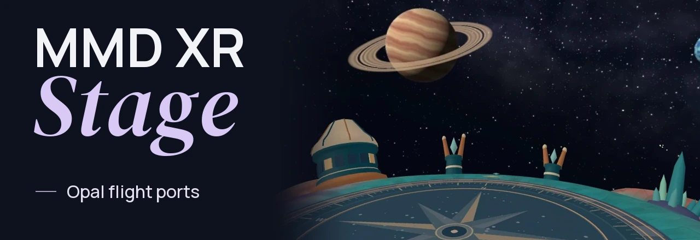
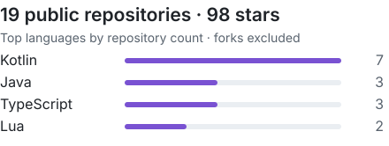

# NekoLaska

I build Android apps with **Kotlin** and **Compose Multiplatform**, design virtual stages for the browser, and make MaiBot plugins at **[RoselindLabs](https://github.com/RoselindLabs)**.

<!-- Cover adapted from the project's own screenshot: https://github.com/znzsofficial/mmd-xr-stage/blob/b799eda3b2879a639dfc7ff89ae671ea570358d2/docs/screenshots/opal-compass.webp -->

Bring a character and a motion file to **[MMD XR Stage](https://github.com/znzsofficial/mmd-xr-stage)**. Watch the performance in a browser, or step onto the same set in VR with a Meta Quest. [Visit Opal flight ports →](https://mmd-xr-stage.pages.dev/?set=glassPlanet&view=screen)

## Android & multiplatform

**[NeLuaJ+](https://github.com/znzsofficial/NeLuaJ)** · Android IDE  
Write Lua on your phone and build it into an Android app without switching to a desktop.

**[CalabiYauVoice](https://github.com/znzsofficial/CalabiYauVoice_GUI)** · Compose Multiplatform  
Browse the Strinova Wiki’s character voices and download clips on Android or Windows.

## [RoselindLabs](https://github.com/RoselindLabs)

Our open-source organization builds plugins for MaiBot. [Neko Web](https://github.com/RoselindLabs/neko-web) lets it read a page during a conversation, [Neko Draw](https://github.com/RoselindLabs/neko-draw) makes images, and [Neko TTS](https://github.com/RoselindLabs/neko-tts) gives its replies a voice.

## Contribution skyline

<picture>
  <source media="(prefers-color-scheme: dark)" srcset="https://raw.githubusercontent.com/znzsofficial/znzsofficial/output/city-dark.svg">
  
</picture>

<picture>
  <source media="(prefers-color-scheme: dark)" srcset="https://raw.githubusercontent.com/znzsofficial/znzsofficial/output/snake-dark.svg">
  
</picture>

  
Repository counts, stars &amp; languages

   
  <picture>
    <source media="(prefers-color-scheme: dark)" srcset="https://raw.githubusercontent.com/znzsofficial/znzsofficial/output/repos-dark.svg">
    
  </picture>

---

[Bilibili](https://space.bilibili.com/15544900) · [All repositories](https://github.com/znzsofficial?tab=repositories)
