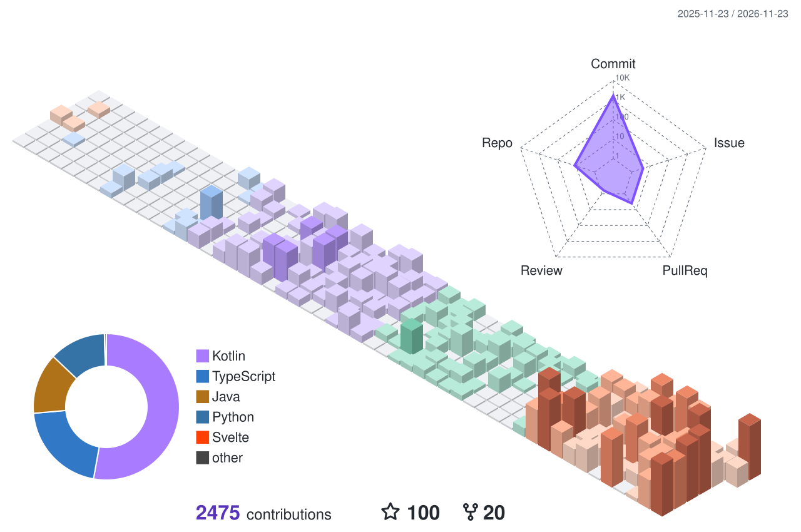

# 👋 Hi, I'm NekoLaska
### `@znzsofficial`

Android & **Compose Multiplatform** developer.  
Building cross-platform UIs with **Kotlin**.

 

---

### About
- Focus: **Android** + **Compose Multiplatform**
- Favorite language: **Kotlin** ❤️
- Also using / learning: Java · C · TypeScript · Lua
- Open to chat about Android, Kotlin, and multiplatform UI

---

### Contribution skyline

  <picture>
    <source media="(prefers-color-scheme: dark)" srcset="https://raw.githubusercontent.com/znzsofficial/znzsofficial/output/city-dark.svg">
    
  </picture>

  <picture>
    <source media="(prefers-color-scheme: dark)" srcset="https://raw.githubusercontent.com/znzsofficial/znzsofficial/output/snake-dark.svg">
    
  </picture>

---

### GitHub Stats

